# Guía Visual de Uso e Interpretación — VektorTerminal

Esta guía complementa al [Manual de Usuario](MANUAL_USUARIO.md) mostrando **qué se hace**, **qué información brinda** y **cómo interpretar cada módulo** de **VektorTerminal** con capturas reales del sistema.

---

## 0. Pantalla de Bienvenida (Portal Público)

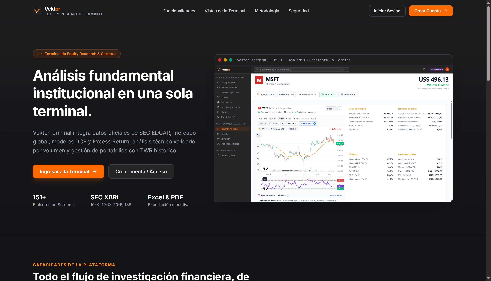

- **Qué se hace acá:**
  - Conocer las capacidades de **VektorTerminal**, explorar capturas interactivas de los módulos principales y acceder a **Iniciar Sesión** o **Crear Cuenta**.

---

## 1. Acceso, Registro y Roles

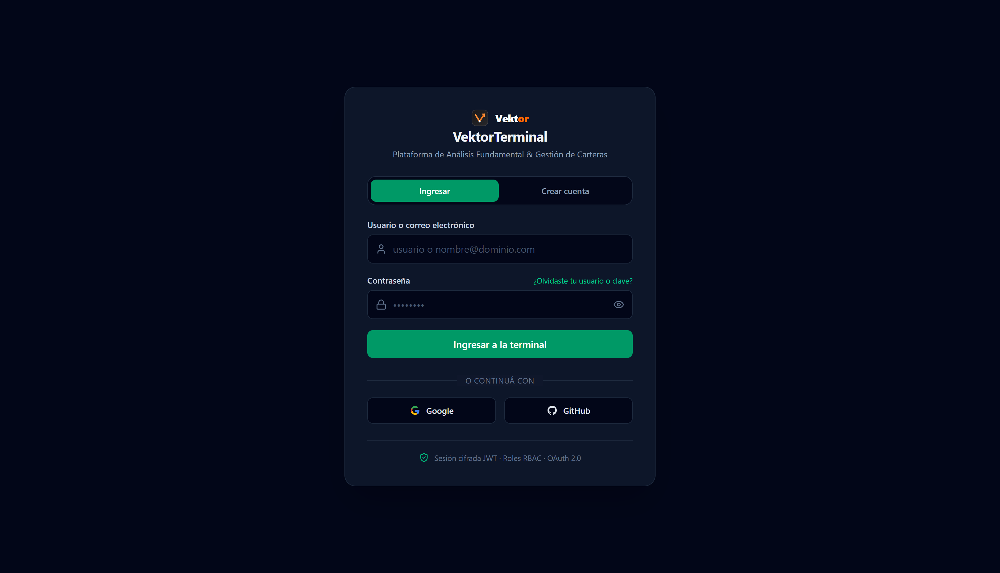

- **Qué se hace acá:**
  - Iniciar sesión con **nombre de usuario** o **correo electrónico** y contraseña.
  - En entornos privados con `VEKTOR_INVITE_CODE` configurado, tus invitados pueden registrarse desde la pestaña **Crear cuenta** ingresando el código de invitación; si el registro público está cerrado, solo el `superadmin` crea cuentas desde **Usuarios y Roles**.
  - Recuperar acceso mediante código temporal de 15 minutos o ingresar con Google/GitHub si OAuth está habilitado.
- **Qué información brinda:**
  - Estado de sesión JWT, rol asignado (`superadmin`, `advisor` o `client`) y acceso directo a cambio de clave cuando corresponde.
- **Cómo interpretarlo:**
  - `client` accede a todo el análisis fundamental, screener, modelos, watchlists y a su propia cartera; `advisor` suma la gestión de clientes asignados; `superadmin` administra usuarios y roles.

---

## 2. Inicio y Mercado

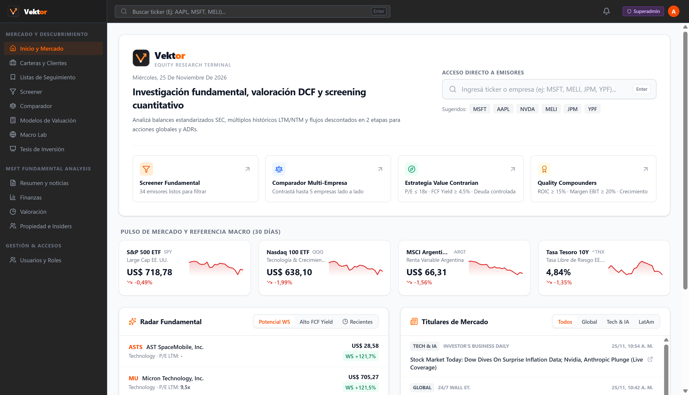

- **Qué se hace acá:**
  - Tomar el pulso diario del mercado en segundos antes de analizar empresas puntuales.
  - Buscar cualquier ticker o empresa desde el buscador central, retomar emisores recientes o saltar directo a presets del Screener.
- **Qué información brinda:**
  - **Benchmarks principales:** `SPY` (S&P 500), `QQQ` (Nasdaq 100), `ARGT` (MSCI Argentina) y `^TNX` (Tasa del Tesoro EE. UU. a 10 años) con variación diaria y sparkline de 30 días.
  - **Radar Fundamental** y **Titulares de Mercado** traducidos al español.
- **Cómo interpretarlo:**
  - Si `^TNX` sube fuerte, la tasa libre de riesgo presiona a la baja las valuaciones de empresas de alto crecimiento (*long-duration*).
  - Usá el **Radar Fundamental** para detectar rápidamente emisores con múltiplos comprimidos o alto retorno sobre capital antes de profundizar en su ficha.

---

## 3. Resumen de Empresa, Gráfico Interactivo y Análisis Técnico

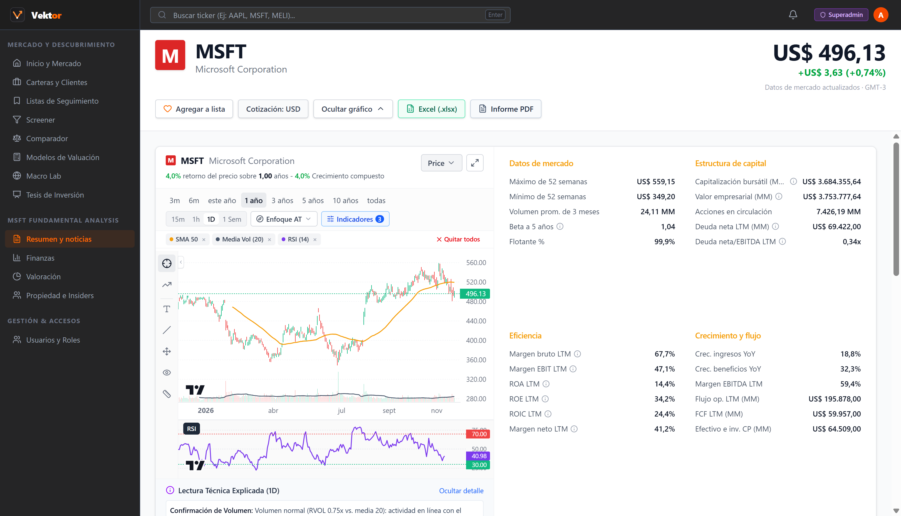

- **Qué se hace acá:**
  - Analizar la acción del precio (rangos `3m` a `max`, velas `15m`, `1h`, `1D`, `1 Sem`), alternar entre métricas (`Price`, `% Change`, `Total Return`, `Drawdowns`, `10k Growth`, `Market Cap`, `Enterprise Value`), activar indicadores técnicos (`SMA 20/50/200`, `EMA 21`, `Bollinger`, `VWAP`, `RSI`, `MACD`, `ATR` disponibles sobre `Price`) o elegir una lente en **Enfoque AT**, y alternar entre **Modo Claro / Oscuro** o colapsar el menú lateral desde la barra superior.
  - Revisar en el panel derecho (**CapitalStructurePanel**) la foto instantánea de valoración, estructura de capital, márgenes y dividendos.
- **Qué información brinda:**
  - Gráfico OHLCV interactivo + panel de osciladores (`RSI`, `MACD`, `ATR`) + **Lectura Técnica Explicada** con validación por volumen relativo (`RVOL`).
  - Cabecera con moneda de cotización (`USD`) y, cuando difiere, moneda original del balance (`Balance: ARS`, `BRL`, etc.).
- **Cómo interpretarlo:**
  - **Total Return vs. Price:** en empresas con dividendos relevantes, `Total Return` refleja el retorno total reinvirtiendo dividendos.
  - **RVOL (Volumen Relativo):** un quiebre de tendencia o media móvil (`SMA 50` / `SMA 200`) con `RVOL ≥ 1,5x` tiene respaldo institucional; con `RVOL ≤ 0,7x` suele ser ruido o falta de convicción.
  - **Market Cap / Enterprise Value:** cuando existe histórico en SEC (`20-F`/`10-K`), la curva usa acciones ajustadas por splits y deuda neta anual histórica; el badge superior indica la fuente utilizada.

---

## 4. Finanzas (Estados Contables, Tarjetas Rápidas y Ratios)

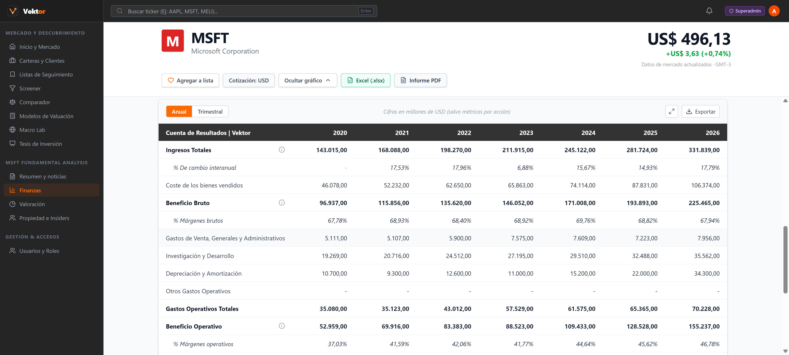

- **Qué se hace acá:**
  - Alternar entre **Cuenta de Resultados**, **Balance de Situación**, **Estado de Flujo de Efectivo** y **Ratios**, en vista **Anual** o **Trimestral**, ampliar la tabla a pantalla completa y exportar a Excel (`.xlsx`).
  - Hacer clic en cualquier ícono `(i)` para abrir el glosario lateral con fórmula, criterio de tesis y ejemplo práctico.
- **Qué información brinda:**
  - Cifras estandarizadas desde SEC EDGAR (`10-K`, `10-Q`, `20-F`, `6-K`) con respaldo normalizado, expresadas en millones de la moneda de reporte (indicada arriba de la tabla).
  - En **Trimestral**, los flujos se filtran por duración de trimestre aislado (`~90 días`) para no mezclar acumulados YTD.
  - En **Ratios** (vista **Anual**): ROA, ROE, **ROIC**, **ROIIC incremental**, **Tasa de Reinversión**, **FCF post-SBC**, márgenes, **DuPont (3 y 5 factores)**, ciclo de conversión de efectivo (`CCC`), liquidez y solvencia.
- **Cómo interpretarlo:**
  - **FCF vs. FCF Ajustado por SBC:** en empresas tecnológicas, si la compensación en acciones (`SBC`) supera el `25%–30%` del FCF, parte de esa caja "libre" en realidad se compensa emitiendo acciones.
  - **ROIC y ROIIC:** un negocio *compounder* suele sostener `ROIC > 15%` con `ROIIC` alto y capacidad de reinversión positiva.
  - **Bancos / Financieras:** el sistema omite márgenes brutos, EBITDA y ROIC donde no aplican; priorizá **ROE**, **P/BV**, **P/TBV** y calidad de activos.

---

## 5. Valoración (Auditoría Contable, Consenso y DCF Inverso)

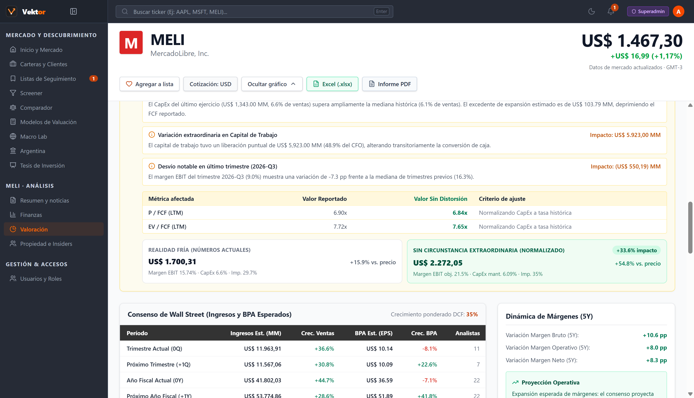

- **Qué se hace acá:**
  - Evaluar si la acción está barata o cara respecto a su propia historia (5 años) y qué crecimiento está descontando el precio actual del mercado.
- **Qué información brinda:**
  - **Enrutamiento Sectorial:** usa **DCF en 2 Etapas** para empresas corporativas estándar y **Excess Return (`ROE vs. Ke`) + `P/TBV`** para bancos/entidades financieras.
  - **Auditoría de Calidad Contable:** detecta ciclos extraordinarios de CapEx de crecimiento (recalculando `P/FCF` normalizado), partidas no operativas, alta dilución por `SBC` y swings de capital de trabajo.
  - **Consenso de Wall Street:** estimaciones `0Q`, `+1Q`, `0Y`, `+1Y` de ingresos y EPS (convertidas a USD en ADRs extranjeros) + enlaces a `8-K` recientes.
  - **DCF Inverso (Expectations Investing):** calcula la tasa de crecimiento anual (o ROE sostenible en bancos) implícita en el precio actual a 5 y 10 años, comparándola contra historia y consenso.
- **Cómo interpretarlo:**
  - Si la **Auditoría** marca *CapEx de crecimiento*, el `P/FCF` reportado puede verse artificialmente caro hoy; mirá el `P/FCF` normalizado a CapEx de mantenimiento.
  - Si el **DCF Inverso** exige menos crecimiento del que la empresa viene logrando y del que proyecta el consenso (`Vara conservadora`), hay margen de seguridad; si exige mucho más (`Expectativas exigentes`), cualquier tropiezo trimestral castigará el múltiplo.

---

## 6. Propiedad Institucional (13F) e Insiders (Form 4)

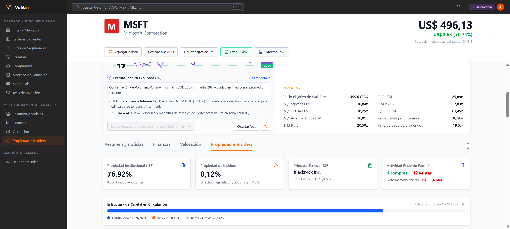

- **Qué se hace acá:**
  - Verificar quién tiene la empresa (fondos institucionales y mutuos) y qué están haciendo los directivos/ejecutivos con su propio dinero.
- **Qué información brinda:**
  - Porcentaje en manos de instituciones e insiders, conteo de compras vs. ventas netas recientes en **Form 4**, y top tenedores `13F` y fondos mutuos.
- **Cómo interpretarlo:**
  - Las ventas automáticas de ejecutivos suelen ser programadas (planes `10b5-1` o impuestos por vesting de acciones); en cambio, las **compras en mercado abierto (*Purchase*)** por parte de CEO/CFO o directores suelen ser una señal fuerte de convicción.

---

## 7. Listas de Seguimiento (Watchlists) y Alertas

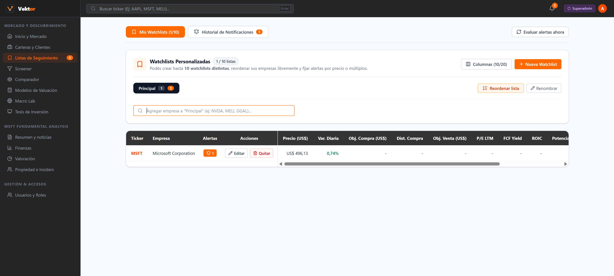

- **Qué se hace acá:**
  - Organizar listas temáticas propias (hasta 10 listas por usuario), reordenar filas, definir precios objetivo de compra/venta, anotar tesis breves y configurar alertas por métricas (`P/E`, `EV/EBITDA`, `FCF Yield`, `ROIC`, etc.).
- **Qué información brinda:**
  - Tablero configurable con cotización actual, distancia a objetivos y **alertas automáticas de nuevos filings SEC (`10-K`, `10-Q`, `20-F`, `6-K`)** presentados en los últimos 30 días.
- **Cómo interpretarlo:**
  - Definí tus objetivos de compra con margen de seguridad antes de que ocurra la volatilidad; cuando el precio o un múltiplo cruza tu umbral, o entra un nuevo balance SEC, aparece en la campana de notificaciones.

---

## 8. Screener Fundamental

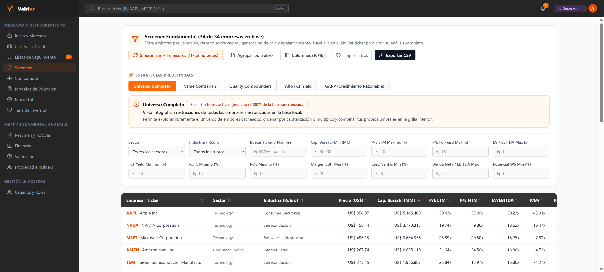

- **Qué se hace acá:**
  - Filtrar un universo curado de acciones globales y ADRs LatAm por sector, industria, tamaño, valoración, rentabilidad, deuda y crecimiento, o aplicar estrategias predefinidas.
  - Actualizar o completar toda la base con **un solo clic** (`Completar base (N)` / `Actualizar base (N)`): procesa en segundo plano en lotes de 4 emisores mientras muestra el progreso en pantalla y en la píldora superior `Screener X/N`, permitiendo seguir usando toda la plataforma o frenar en cualquier momento con **Detener**.
- **Qué información brinda:**
  - Tabla ordenable con 16 métricas clave (`P/E LTM/NTM`, `EV/EBITDA`, `P/FCF`, `FCF Yield %`, `Margen EBIT`, `ROIC`, `ROE`, `DN/EBITDA`, `Crec. Ventas`, `Potencial WS`).
- **Cómo interpretarlo:**
  - Combiná **calidad** (`ROIC > 15%`, `DN/EBITDA < 2x`) con **valuación** (`FCF Yield > 4%` o `P/E NTM` razonable) para armar una lista corta de ideas antes de pasar al Comparador o a Valoración.

---

## 9. Comparador Multi-Empresa

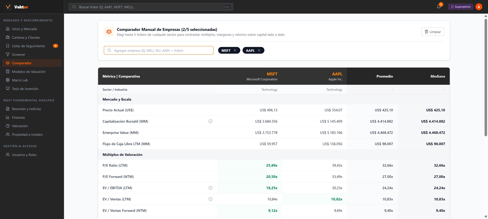

- **Qué se hace acá:**
  - Enfrentar hasta 5 tickers lado a lado en una misma tabla para contrastar múltiplos, eficiencia, apalancamiento y crecimiento.
- **Qué información brinda:**
  - Valores individuales por empresa más **Promedio** y **Mediana** del grupo.
- **Cómo interpretarlo:**
  - Te permite detectar rápidamente si una empresa cotiza más barata que sus pares por falta de calidad (márgenes/ROIC inferiores o mayor deuda) o si realmente ofrece mejor relación calidad/precio.

---

## 10. Modelos de Valuación (DCF 2 Etapas y Excess Return)

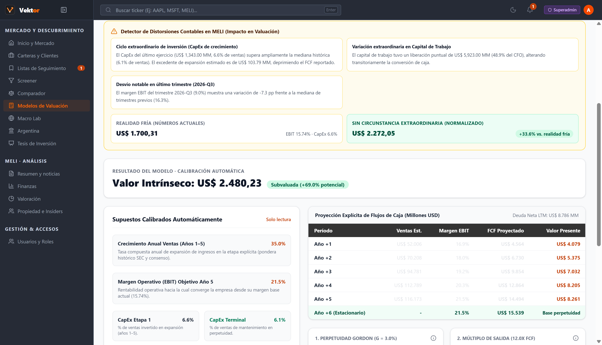

- **Qué se hace acá:**
  - Ajustar manualmente supuestos de crecimiento de ventas, margen EBIT, CapEx de expansión vs. mantenimiento, `WACC`, múltiplo de salida y crecimiento terminal `g` (o `ROE` / `Ke` / `P/TBV` en bancos), además de probar escenarios rápidos (*Estrés*, *Base*, *Favorable*).
- **Qué información brinda:**
  - Valor intrínseco por acción, potencial alcista/bajista (`Upside %`), tabla año a año de flujos descontados, comparación entre **Gordon Growth** y **Múltiplo de Salida**, y **matriz de sensibilidad `WACC vs. g`**.
- **Cómo interpretarlo:**
  - Nunca confíes en un único número puntual: mirá la **matriz de sensibilidad `WACC vs. g`** para comprobar si la acción sigue ofreciendo margen de seguridad aun con `WACC +1%` y `g -0,5%`.

---

## 11. Macro Lab

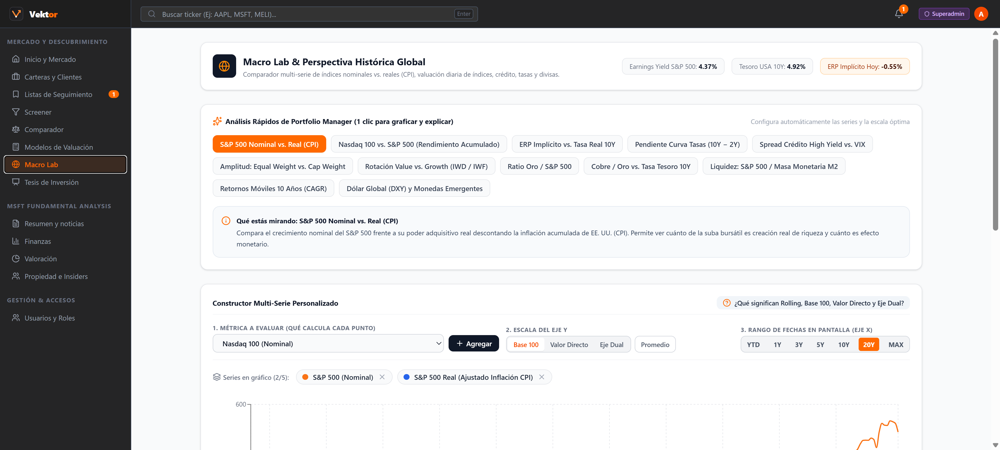

- **Qué se hace acá:**
  - Evaluar el contexto macroeconómico de EE. UU. y la valuación relativa de los principales índices bursátiles antes de asignar capital.
- **Qué información brinda:**
  - Series históricas ajustadas por inflación (`CPI` de FRED), tasas del Tesoro (`10Y`, `2Y`, `3M`), tasas reales (`TIPS`), diferenciales de crédito *High Yield*, **Equity Risk Premium (`ERP`)** y snapshots diarios de `P/E` y `Earnings Yield` de `SPY`, `QQQ`, `DIA`, `IWM`, `EWZ` y `EEM` (`N/D` cuando Yahoo no informa P/E).
- **Cómo interpretarlo:**
  - Un **ERP** comprimido o negativo frente a bonos del Tesoro sugiere que la bolsa ofrece poco premio por asumir riesgo accionario respecto a renta fija libre de riesgo.
  - Comparar el `P/E` actual de cada índice contra su media histórica te ayuda a calibrar expectativas de retorno de mercado.

---

## 12. Tesis de Inversión (One-Pager Ejecutivo)

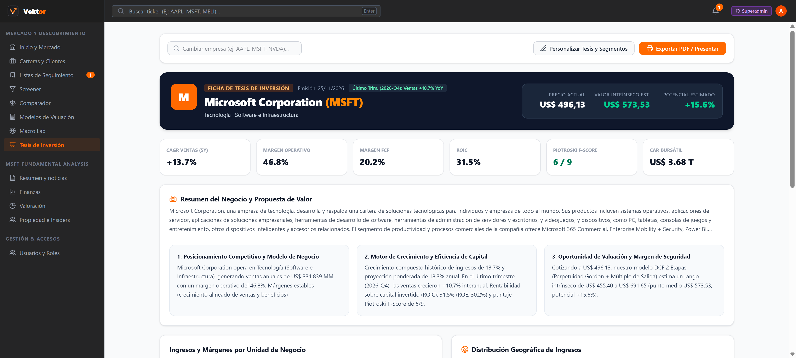

- **Qué se hace acá:**
  - Compilar un resumen ejecutivo imprimible / exportable a PDF (`Ctrl+P`) con la historia del negocio, segmentos de ingresos/geografía (editables por `advisor`/`superadmin`), trayectoria de 5 años, valuación intrínseca y riesgos clave.
- **Qué información brinda:**
  - Ficha completa lista para revisar o compartir una tesis de inversión documentada.
- **Cómo interpretarlo:**
  - Si no podés resumir en 3 párrafos por qué gana dinero la empresa, qué ventaja competitiva tiene y qué puede salir mal, la tesis todavía no está madura para invertir.

---

## 13. Carteras y Clientes (CRM + PPP + TWR)

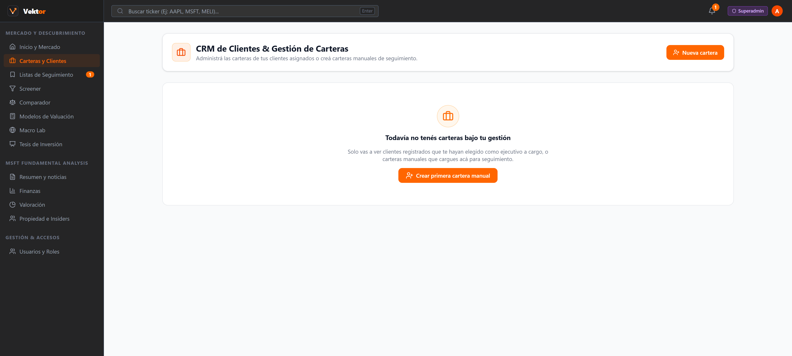

- **Qué se hace acá:**
  - Llevar el registro de operaciones (`BUY`, `SELL`, `DIVIDEND`, `DEPOSIT`, `WITHDRAWAL`) de tu propia cartera (o de clientes asignados si sos `advisor`), siempre en la **moneda base** de la cartera para mantener consistencia contable.
- **Qué información brinda:**
  - Tenencias consolidadas, **Precio Promedio Ponderado (`PPP`)**, resultado realizado y no realizado, dividendos cobrados, saldo de caja, cotización en vivo convertida automáticamente por FX a la moneda base, y **TWR (*Time-Weighted Return*)** encadenado por sub-períodos.
- **Cómo interpretarlo:**
  - **PPP:** muestra tu costo promedio real incluyendo comisiones; sirve para medir ganancia/pérdida fiscal y económica por posición.
  - **TWR:** mide qué tan bien elegiste activos aislando el efecto de cuándo pusiste o sacaste dinero (depósitos y retiros), permitiéndote comparar tu gestión directamente contra `SPY` o `QQQ`.
